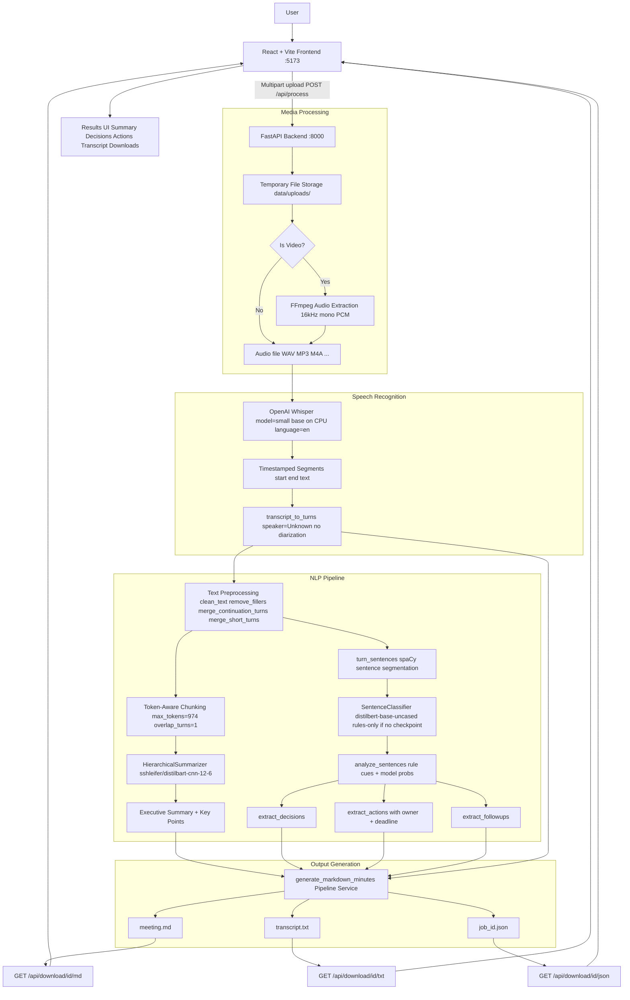
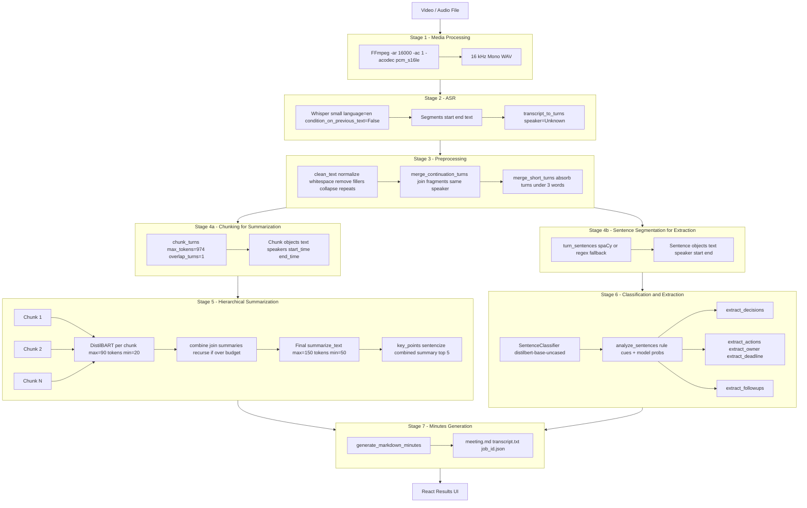
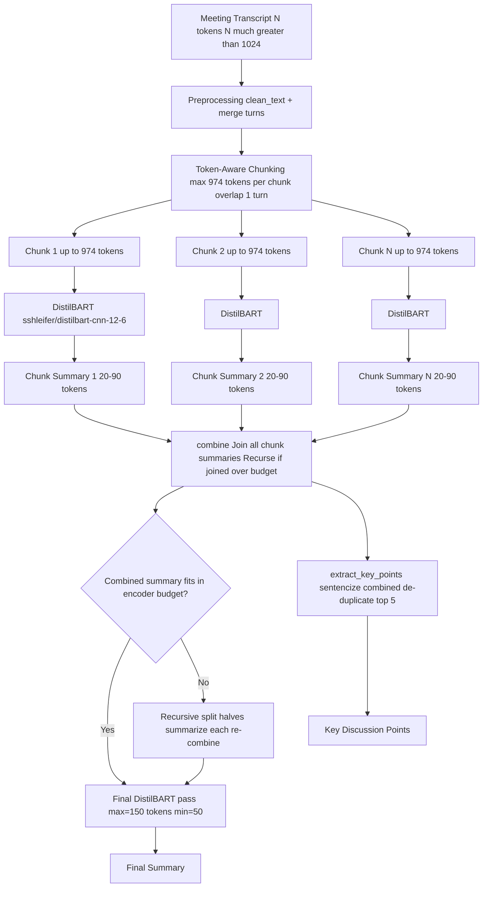

# Automated Meeting Minutes Generator

> **Academic Project — Team 14 · Roll Numbers 303-307**
> **Domain: Text Generation and Summarization**

An end-to-end NLP system that accepts a meeting recording (video or audio), extracts speech, transcribes it, summarises the content, identifies decisions and action items, and presents structured meeting minutes through a modern React web interface.


---

## Table of Contents

1. [Project Description](#project-description)
2. [System Architecture](#system-architecture)
3. [Key Features](#key-features)
4. [Technology Stack](#technology-stack)
5. [Prerequisites](#prerequisites)
6. [Getting Started](#getting-started)
7. [Running the Application](#running-the-application)
8. [API Endpoints](#api-endpoints)
9. [Project Structure](#project-structure)
10. [Detailed Pipeline Explanation](#detailed-pipeline-explanation)
11. [How Summarization Actually Works](#how-summarization-actually-works)
12. [Evaluation Methodology and Metrics](#evaluation-methodology-and-metrics)
13. [Testing](#testing)
14. [Live Demo Walkthrough](#live-demo-walkthrough)
15. [Troubleshooting](#troubleshooting)
16. [Academic Requirement Mapping](#academic-requirement-mapping)
17. [Limitations and Honest Assessment](#limitations-and-honest-assessment)
18. [License](#license)

---

## Project Description

The **Automated Meeting Minutes Generator** addresses the academic requirement:

> *Develop an automated meeting minutes generator that transcribes meetings and summarises key discussion points, decisions, and action items.*

The system ingests a raw recording (MP4, MOV, MKV, WAV, MP3, M4A, FLAC), runs a multi-stage NLP pipeline, and produces:

- A faithful **executive summary** of the meeting
- Identified **key discussion points**
- Conservatively detected **decisions** (only when explicit commitment language is present)
- **Action items** with owner and deadline (only when explicitly stated; never invented)
- A scrollable **full transcript** for verification
- Downloads in **Markdown (.md)**, **plain text (.txt)**, and **JSON (.json)** formats

The output is explicitly marked as a *draft for human review* — the system does not claim to be an authoritative record.

---

## System Architecture



---

## Key Features

| Feature | Status | Notes |
|---|---|---|
| Video / audio upload via drag-and-drop | Implemented | MP4, MOV, MKV, WAV, MP3, M4A, FLAC |
| FFmpeg audio extraction (16 kHz mono PCM) | Implemented | Optimal format for Whisper |
| Whisper speech-to-text | Implemented | `small` on GPU, `base` fallback on CPU |
| Text preprocessing (filler removal, turn merging) | Implemented | Cue words never removed |
| Token-aware chunking with overlap | Implemented | Handles recordings of any length |
| Hierarchical summarization (DistilBART) | Implemented | chunk to combine to final |
| Key discussion points extraction | Implemented | Derived from summary, de-duplicated |
| Conservative decision detection | Implemented | Rules + optional DistilBERT classifier |
| Action item extraction with owner and deadline | Implemented | spaCy + regex; "Not specified" when absent |
| Follow-up / open item detection | Implemented | Regex cue patterns |
| Speaker diarization | Not implemented | Documented as future work |
| Confidence bars per decision/action | Implemented | Rule-only items show 0.50 (neutral) |
| Download: Markdown / TXT / JSON | Implemented | Via /api/download/{id}/{format} |
| Real-time processing status in UI | Implemented | Polls every 2.5 s |
| Source verification in minutes | Implemented | Speaker + timestamp + signals per item |
| Async background processing | Implemented | FastAPI BackgroundTasks |

---

## Technology Stack

| Layer | Technology | Version / Detail |
|---|---|---|
| **Frontend framework** | React | 19 |
| **Frontend build tool** | Vite | 8 |
| **HTTP client (frontend)** | Axios | 1.20+ |
| **Frontend icons** | Lucide React | 1.52+ |
| **Backend framework** | FastAPI | with Uvicorn |
| **Speech recognition** | OpenAI Whisper | `small` / `base` (auto-selected) |
| **Summarization** | `sshleifer/distilbart-cnn-12-6` | ~1.2 GB |
| **Sentence classification** | `distilbert-base-uncased` | 3-class head (other/decision/action) |
| **NLP (entity/sentence)** | spaCy `en_core_web_sm` | Sentence splitting + NER |
| **Audio extraction** | FFmpeg | System binary / imageio-ffmpeg fallback |
| **Deep learning runtime** | PyTorch | CPU or CUDA auto-detected |
| **HuggingFace pipeline** | Transformers | `pipeline("summarization")` |
| **ROUGE evaluation** | rouge_score | Local computation |
| **BERTScore evaluation** | bert_score | Optional, downloads on first use |
| **WER evaluation** | jiwer | Requires reference transcripts |
| **ML metrics** | scikit-learn | Precision / Recall / F1 |
| **Config management** | PyYAML | `configs/config.yaml` |
| **Frontend styling** | Vanilla CSS (custom) | Glassmorphism dark theme, Inter + Outfit fonts |
| **Python** | 3.10+ | |
| **Package manager (Python)** | pip | |
| **Package manager (JS)** | npm | |

---

## Prerequisites

### System Requirements

| Requirement | Minimum | Notes |
|---|---|---|
| Python | 3.10+ | 3.11 recommended |
| Node.js | 18+ | 20 LTS recommended |
| npm | 9+ | Bundled with Node.js |
| FFmpeg | Any recent | Required for video input |
| RAM | 8 GB | 16 GB recommended |
| GPU | Optional | CUDA auto-detected; CPU fallback works |
| Disk space | ~4 GB free | Whisper + DistilBART model downloads |

### Installing FFmpeg on Windows

```powershell
# Option A - via winget (Windows 10/11)
winget install Gyan.FFmpeg

# Option B - via Chocolatey
choco install ffmpeg

# Option C - manually
# Download from https://ffmpeg.org/download.html
# Extract and add the bin/ folder to your PATH
```

Verify: `ffmpeg -version`

> **Note:** If FFmpeg is not on PATH, the backend falls back to the imageio-ffmpeg bundled binary. Install system FFmpeg for full video support.

---

## Getting Started

### 1 - Clone the repository

```bash
git clone https://github.com/your-team/automated-meeting-minutes-generator
cd automated-meeting-minutes-generator
```

### 2 - Set up Python virtual environment

```bash
python -m venv venv

# Windows PowerShell:
.\.venv\Scripts\Activate.ps1

# Windows CMD:
venv\Scripts\activate.bat

# macOS / Linux:
source venv/bin/activate
```

### 3 - Install Python dependencies

```bash
pip install -r requirements.txt
```

> **GPU (CUDA) users:** Install CUDA PyTorch first:
> ```bash
> pip install torch --index-url https://download.pytorch.org/whl/cu121
> ```

### 4 - Download the spaCy English model

```bash
python -m spacy download en_core_web_sm
```

### 5 - Install frontend dependencies

```bash
cd frontend
npm install
cd ..
```

### 6 - Verify the environment

```bash
python -m pytest -q tests/
```

All tests should pass without any model download.

---

## Running the Application

### Start the backend

```bash
python -m uvicorn backend.app.main:app --host 127.0.0.1 --port 8000 --reload
```

API available at: **http://127.0.0.1:8000**
Interactive API docs: **http://127.0.0.1:8000/docs**

> **First run:** Whisper (~461 MB) and DistilBART (~1.2 GB) download automatically from HuggingFace Hub. Internet connection required.

### Start the frontend

```bash
cd frontend
npm run dev
```

Frontend available at: **http://localhost:5173**

### Processing flow

```
Upload recording (browser)
        |
POST /api/process  -> job_id returned immediately
        |
Background task starts (FastAPI BackgroundTasks)
        |
Poll GET /api/process/{job_id} every 2.5 s
        |
status: completed -> results displayed in UI
        |
Download: /api/download/{job_id}/{md|txt|json}
```

---

## API Endpoints

| Method | Endpoint | Description |
|---|---|---|
| GET | `/` | Health check — returns `{"message": "Meeting Minutes API is running."}` |
| POST | `/api/process` | Upload meeting file and start processing |
| GET | `/api/process/{job_id}` | Poll job status and retrieve results |
| GET | `/api/download/{job_id}/{format}` | Download output file (md/txt/json) |

### POST /api/process

**Request:** `multipart/form-data`

| Field | Type | Description |
|---|---|---|
| `video` | File | Meeting recording (MP4, MOV, MKV, WAV, MP3, M4A, FLAC) |

**Response:**
```json
{
  "success": true,
  "job_id": "7e6935a1-9d01-4c30-b5aa-ea0cd5d12226"
}
```

**Errors:** 400 if no file or unsupported format.

---

### GET /api/process/{job_id}

**Response while processing:**
```json
{
  "job_id": "7e6935a1-...",
  "status": "processing",
  "step": "summarizing"
}
```

Step values in order: `starting` → `extracting_audio` (video only) → `transcribing` → `preprocessing` → `summarizing` → `extracting`

**Response on completion:**
```json
{
  "job_id": "7e6935a1-...",
  "status": "completed",
  "results": {
    "metadata": {
      "meeting_id": "7e6935a1-...",
      "title": "Not specified",
      "date": "Not specified",
      "participants": []
    },
    "pipeline_info": {
      "transcription_model": "Whisper (small)",
      "summarization_model": "sshleifer/distilbart-cnn-12-6",
      "speaker_diarization": false,
      "note": "Speaker identification is not available."
    },
    "transcript": "This is the kickoff meeting...",
    "summary": "The team held a kickoff meeting for a new remote control project...",
    "key_points": ["Key point 1", "Key point 2"],
    "decisions": [
      {"text": "We are going to be selling this for 25 euro.", "confidence": 0.5}
    ],
    "action_items": [
      {"text": "...", "owner": "Industrial Designer", "deadline": null, "confidence": 0.5}
    ],
    "follow_ups": [
      {"text": "The next meeting is in 30 minutes."}
    ]
  }
}
```

**Response on failure:**
```json
{"job_id": "...", "status": "failed", "error": "No speech detected or empty transcript."}
```

---

### GET /api/download/{job_id}/{format}

| format | Content |
|---|---|
| `md` | Formatted Markdown meeting minutes |
| `txt` | Plain text transcript |
| `json` | Full structured results |

---

## Project Structure

```
automated-meeting-minutes-generator/
|
+-- backend/                         # FastAPI application
|   +-- app/
|       +-- main.py                  # FastAPI app, CORS, router
|       +-- routes/
|       |   +-- meetings.py          # /api/process, /api/process/{id}, /api/download
|       +-- services/
|           +-- pipeline_service.py  # Background task, status, Markdown generation
|           +-- video_service.py     # FFmpeg audio extraction (16 kHz, mono, PCM)
|
+-- ml/                              # All ML/NLP code
|   +-- pipeline.py                  # run_pipeline() -- top-level orchestrator
|   +-- asr.py                       # WhisperASR, word_error_rate(), transcript_to_turns()
|   +-- preprocessing.py             # Turn, Sentence, clean_text(), sentencize()
|   +-- chunking.py                  # Chunk dataclass, chunk_turns(), count_tokens()
|   +-- summarizer.py                # HierarchicalSummarizer (DistilBART)
|   +-- classifier.py                # SentenceClassifier (DistilBERT), fine_tune()
|   +-- extraction.py                # extract_decisions(), extract_actions(), extract_followups()
|   +-- minutes_generator.py         # render_minutes() -> Markdown output
|   +-- evaluation.py                # rouge_scores(), bertscore(), classification_metrics(), WER
|   +-- config.py                    # YAML config loader
|   +-- utils.py                     # Logging, seeding, hardware detection, save_json()
|   +-- data_loader.py               # Load .txt / .json transcript files
|   +-- baselines.py                 # TF-IDF, TextRank, LSTM baselines
|
+-- frontend/                        # React + Vite SPA
|   +-- index.html
|   +-- package.json
|   +-- vite.config.js
|   +-- src/
|       +-- main.jsx                 # React entry point
|       +-- App.jsx                  # UploadPanel + ProcessingScreen + ResultsPanel
|       +-- index.css                # Dark glassmorphism theme, Inter + Outfit fonts
|       +-- App.css
|
+-- tests/                           # Unit tests (pytest)
|   +-- test_asr.py
|   +-- test_chunking.py
|   +-- test_preprocessing.py
|   +-- test_extraction.py
|   +-- test_evaluation.py
|   +-- test_minutes_generator.py
|   +-- test_summarizer_data.py
|   +-- test_baselines.py
|   +-- test_config_utils.py
|
+-- configs/
|   +-- config.yaml                  # Central configuration (models, thresholds, paths)
|
+-- data/
|   +-- uploads/                     # Temporary uploaded files (auto-cleaned)
|   +-- outputs/                     # Results: .json, .md, .txt per job_id
|
+-- models/                          # Fine-tuned classifier checkpoints (if trained)
+-- notebooks/                       # Jupyter / Colab notebooks
+-- scripts/                         # Utility scripts
+-- outputs/                         # Pipeline artefacts, metrics, logs
+-- ES2002a.Mix-Headset.wav          # Sample meeting recording (AMI corpus)
+-- demostandup.mp3                  # Sample standup recording
+-- requirements.txt
+-- README.md
```

---

## Detailed Pipeline Explanation

### Data Flow Diagram



### Stage 1 - Audio Extraction

**File:** `backend/app/services/video_service.py`

For video uploads, FFmpeg extracts audio:

```
ffmpeg -i <input> -vn -acodec pcm_s16le -ar 16000 -ac 1 <output.wav>
```

- `-ar 16000`: 16 kHz sample rate — Whisper native format
- `-ac 1`: mono channel
- `-acodec pcm_s16le`: 16-bit signed PCM, lossless
- `-vn`: strip the video stream

Audio files (WAV, MP3, M4A, etc.) bypass this stage.

---

### Stage 2 - Speech Recognition (Whisper)

**File:** `ml/asr.py`
**Model:** `openai/whisper-small` (auto-downgraded to `base` on CPU)

| Parameter | Value | Rationale |
|---|---|---|
| Model size | `small` (GPU) / `base` (CPU) | Balance of accuracy vs. speed |
| Language | `en` | Fixed; no auto-detect for meeting use |
| `condition_on_previous_text` | `False` | Reduces hallucination cascades |
| Output | Timestamped segments `{id, start, end, text}` | Enables timestamp provenance |
| Speaker label | `Unknown` | Diarization is out of scope |

Runs via `whisper.load_model(size).transcribe(...)`. Result converted to `Turn` objects via `transcript_to_turns()`. Model cached in-process.

---

### Stage 3 - Preprocessing

**File:** `ml/preprocessing.py`

Order of operations:

1. **`clean_text()`** — strip `Unknown:` prefixes, normalize whitespace, remove standalone filler words (`um`, `uh`, `er`, `erm`, `hmm`), collapse repeated words
2. **`_merge_continuation_turns()`** — join same-speaker segments when previous lacks terminal punctuation or current starts lowercase
3. **`merge_short_turns()`** — absorb turns shorter than 3 words into their same-speaker neighbour

**Critical design rule:** Cue words (`decided`, `agreed`, `will`, `need to`, `by Friday`) are never removed.

---

### Stage 4 - Chunking

**File:** `ml/chunking.py`

Meeting transcripts exceed BART's 1024-token encoder limit. Token-aware chunking:

| Parameter | Value |
|---|---|
| Max tokens per chunk | 974 (= 1024 minus 50 padding) |
| Overlap turns | 1 turn shared between consecutive chunks |
| Token counting | HuggingFace AutoTokenizer (fallback: chars / 3.9) |
| Over-long single turn | Sentence-boundary split, then word-split |
| Chunk metadata | chunk_id, speakers, start_time, end_time, token_count |

Speaker labels preserved in chunk text so summarizer sees dialogue context.

---

### Stage 5 - Summarization (DistilBART)

**File:** `ml/summarizer.py`
See the dedicated section below.

---

### Stage 6 - Classification and Extraction

**File:** `ml/classifier.py`, `ml/extraction.py`

**Model:** `distilbert-base-uncased` with a 3-class head

| Label | ID | Meaning |
|---|---|---|
| `other` | 0 | General discussion |
| `decision` | 1 | A commitment or resolved question |
| `action` | 2 | A concrete task assigned to someone |

**Two operating modes:**
- **Fine-tuned mode**: checkpoint in `models/classifier/` — model probabilities at threshold 0.60
- **Rules-only mode** (default — no checkpoint): deterministic regex cue patterns; confidence = 0.50

**Decision cues (examples):** `we decided`, `agreed to`, `let's go with`, `approved`, `we will use`, `final decision`, `settled on`, `consensus`

**Action item cues (examples):** `I will`, `I'll`, `we will`, `need to`, `should`, `can you`, `by Monday/Friday/next week`, `schedule`, `assign`, `deadline`, `due by`

**Owner detection priority (never invents):**
1. Speaker of "I will ..." (if not Unknown)
2. Named participant from participant list
3. PERSON entity from spaCy en_core_web_sm
4. Role phrase ("the industrial designer will ...")
5. Capitalized name before "will" at sentence start
6. **"Not specified"** — always the default when nothing explicit found

**Deadline detection:** spaCy DATE/TIME entities + regex patterns (`by Friday`, `by next week`, `due on Monday`, `within 3 days`). Returns "Not specified" when no explicit phrase exists.

---

### Stage 7 - Minutes Generation

**File:** `backend/app/services/pipeline_service.py`

`generate_markdown_minutes()` assembles Markdown output:

- Meeting title, date, participants
- Executive Summary
- Key Discussion Points
- Decisions Agreed Upon (or: *No confirmed decisions detected*)
- Action Items table (Action | Owner | Deadline)
- Follow-ups
- Pipeline provenance footnote

Files saved per job: `{job_id}.json`, `{job_id}.md`, `{job_id}.txt`

---

## How Summarization Actually Works

### The Context-Length Problem

BART-family models have a **fixed maximum encoder input of 1024 tokens**. A 30-minute meeting transcript contains roughly 3,000-6,000 tokens. Passing the full transcript would silently truncate everything after token 1024.

**Solution: Hierarchical (Map-Reduce) Summarization**



### DistilBART Model Details

| Property | Value |
|---|---|
| HuggingFace identifier | `sshleifer/distilbart-cnn-12-6` |
| Architecture | Distilled BART (encoder-decoder Transformer) |
| Training data | CNN/DailyMail news articles |
| Training objective | Abstractive summarization |
| Tokenizer | BartTokenizer (BPE-based) |
| Max encoder input | 1024 tokens |
| Approximate model size | ~1.2 GB (float32) |
| Device | CUDA if available; CPU fallback with OOM retry |

### Inference Parameters

| Parameter | Value | Effect |
|---|---|---|
| `max_length` | 90 tokens (chunks) / 150 tokens (final) | Maximum output length |
| `min_length` | 20 tokens (chunks) / 50 tokens (final) | Prevents degenerate short outputs |
| `do_sample` | `False` | Deterministic beam search |
| `no_repeat_ngram_size` | `3` | Prevents repeated 3-gram phrases |
| `early_stopping` | `True` | Stops when all beams reach EOS |
| `truncation` | `True` | Safety valve |

### Post-processing

After each summarization call, `_polish()` removes spaces before punctuation, doubled punctuation, leaking speaker tags ("Unknown:", "Speaker 1:"), and collapses multiple spaces.

### Known Domain Limitation

DistilBART was trained on **CNN/DailyMail news** — it is a news summarizer, not a meeting summarizer. When meeting transcripts are highly conversational, fragmented, or lack a clear narrative arc, the model may produce summaries that sound like news headlines rather than structured meeting notes. This is a **known, documented limitation**.

---

## Evaluation Methodology and Metrics

> **Critical note:** All metrics are described precisely about what can and cannot be measured. No numbers are fabricated. Where evaluation was not possible due to missing ground truth, this is explicitly stated.

### Component-Level Evaluation Framework

| Component | Measurable Metric | Condition |
|---|---|---|
| **Whisper ASR** | WER, CER | Only if a validated reference transcript exists |
| **DistilBART Summarization** | ROUGE-1, ROUGE-2, ROUGE-L | Only if validated reference summaries exist |
| **DistilBART Summarization** | BERTScore F1 | Optional; downloads distilbert-base-uncased as scorer |
| **Action item extraction** | Precision, Recall, F1 | Only if manually labelled ground truth exists |
| **Decision extraction** | Precision, Recall, F1 | Only if manually labelled ground truth exists |
| **Whole pipeline** | Processing time, RTF | Always measurable |

---

### Speech Recognition - WER / CER

**Word Error Rate:**
```
WER = (S + D + I) / N
  S = word substitutions
  D = word deletions
  I = word insertions
  N = total words in reference transcript
```

Character Error Rate (CER) applies the same formula at character level.

To compute WER (if reference transcript available):

```bash
python -c "
from ml.asr import word_error_rate
ref = open('data/reference/ES2002a.ref.txt').read()
hyp = open('data/outputs/<job_id>.txt').read()
print(f'WER: {word_error_rate(ref, hyp):.3f}')
"
```

> If no validated reference transcript is available: WER cannot be reported. Stating "approximately 95% accurate" without a reference is not a valid metric.

---

### Summarization - ROUGE and BERTScore

**ROUGE-1:** Unigram overlap between generated and reference summaries.

**ROUGE-2:** Bigram overlap — more sensitive to phrase-level accuracy.

**ROUGE-L:** Longest common subsequence — captures fluency and sentence structure.

**BERTScore F1:** Semantic similarity via contextual embeddings — captures paraphrases.

To compute (if reference summaries available):

```python
from ml.evaluation import rouge_scores
scores = rouge_scores(predictions=[generated], references=[reference])
# Returns: {"rouge1": float, "rouge2": float, "rougeL": float, "n_evaluated": int}
```

> If no reference summaries are available: Quantitative quality cannot be established.

**Qualitative Evaluation Protocol (when no reference exists):**

Human evaluator rates each summary from 1-5 on:

| Criterion | Description |
|---|---|
| Factuality | Does it contain only statements supported by the transcript? |
| Relevance | Does it cover the most important topics? |
| Completeness | Are key decisions and topics missing? |
| Readability | Is the text fluent and coherent? |
| Overall usefulness | Would this help someone who missed the meeting? |

This is not an objective accuracy metric — it is explicitly a human assessment.

---

### Action Item and Decision Extraction - Precision / Recall / F1

```
Precision = TP / (TP + FP)   # of predicted items, what fraction are correct?
Recall    = TP / (TP + FN)   # of real items, what fraction were found?
F1        = 2 x Precision x Recall / (Precision + Recall)
```

To compute (if ground truth is labelled):

```python
from ml.evaluation import action_item_metrics
scores = action_item_metrics(predictions=detected_actions, references=labelled_actions)
```

---

### Runtime Performance

For ES2002a.Mix-Headset.wav (~40 MB WAV, approximately 30 minutes):

| Stage | Approximate Time (CPU) | Notes |
|---|---|---|
| Audio extraction | ~0 s (WAV, no extraction) | FFmpeg only for video |
| Whisper transcription | 5-20 min | Very hardware-dependent |
| Preprocessing | < 1 s | Pure Python |
| Chunking | < 1 s | |
| Summarization | 2-8 min per chunk | CPU; much faster on GPU |
| Extraction | < 5 s | spaCy + regex |
| **Total (CPU)** | **~30-60 min** | Whisper + DistilBART dominate |

**Real-Time Factor (RTF):**
```
RTF = Processing Time / Audio Duration

Example: 45 min processing / 30 min audio = RTF 1.5
RTF > 1.0 means slower than real-time -- expected on CPU
```

On a CUDA GPU: RTF typically < 0.3.

---

### Results Summary Table

| Component | Metric | Result | Notes |
|---|---|---|---|
| ASR (Whisper small) | WER | Not evaluated | No validated reference transcript available |
| ASR (Whisper small) | CER | Not evaluated | No validated reference transcript available |
| Summarization (DistilBART) | ROUGE-1 | Not evaluated | No validated reference summaries available |
| Summarization (DistilBART) | ROUGE-2 | Not evaluated | No validated reference summaries available |
| Summarization (DistilBART) | ROUGE-L | Not evaluated | No validated reference summaries available |
| Summarization (DistilBART) | BERTScore F1 | Not evaluated | No validated reference summaries available |
| Decision Extraction | Precision / Recall / F1 | Not evaluated | No labelled ground truth available |
| Action Extraction | Precision / Recall / F1 | Not evaluated | No labelled ground truth available |
| Pipeline (CPU, 30 min audio) | RTF | ~1.5-2.0 | Estimated; hardware-dependent |

> **Academic note:** The evaluation infrastructure (`ml/evaluation.py`) is fully implemented. The absence of numeric results reflects missing ground truth data, not a code gap.

---

## Testing

### Running the test suite

```bash
python -m pytest -q tests/
```

### Test coverage by module

| Test file | What it tests |
|---|---|
| `test_preprocessing.py` | `clean_text`, `sentencize`, `Turn` parsing, `merge_short_turns` |
| `test_chunking.py` | `chunk_turns`, token counting, overlap, over-long turn splitting |
| `test_extraction.py` | Weak labels, decision/action cues, owner detection, deadline, provenance |
| `test_minutes_generator.py` | `render_minutes` Markdown output, "Not specified" defaults |
| `test_evaluation.py` | ROUGE scores, classification metrics, action item metrics |
| `test_asr.py` | WhisperASR instantiation (no model download in tests) |
| `test_summarizer_data.py` | Summarizer configuration and tokenizer loading |
| `test_baselines.py` | TF-IDF and TextRank baseline behavior |
| `test_config_utils.py` | Config loading, deep merge, path resolution |

### Key design principles in tests

- Tests never require model downloads
- Extraction tests use mocked probabilities and Sentence fixtures
- `test_never_invents_fields` verifies generic sentences produce empty decision/action lists
- WER and ROUGE tests verify mathematical correctness of metric implementations

---

## Live Demo Walkthrough

For professor demonstration using `ES2002a.Mix-Headset.wav` or `demostandup.mp3`.

### Step 1 - Launch the application

```bash
# Terminal 1: Backend
python -m uvicorn backend.app.main:app --host 127.0.0.1 --port 8000

# Terminal 2: Frontend
cd frontend && npm run dev
```

Open **http://localhost:5173**

### Step 2 - Upload the recording

1. Drag-and-drop zone is shown on the home screen
2. Click or drag `ES2002a.Mix-Headset.wav` into the zone
3. Filename and size appear with a green check indicator
4. Click **Generate Meeting Minutes**

*Observation:* Button is disabled until a file is selected. Upload is immediate; processing runs in the background.

### Step 3 - Processing screen

Step-by-step processing status:
```
Transcribing audio         [Whisper ASR]
Cleaning and merging turns [Preprocessing]
Generating summary         [DistilBART]
Extracting actions and decisions [Rule-based NLP]
```

Each step animates as active, then shows check when complete.

### Step 4 - Results appear automatically

**Left column:**
- Executive Summary — concise paragraph from DistilBART
- Key Discussion Points — bulleted sentences from combined summary
- Decisions — only sentences with explicit commitment language; confidence bars shown

**Right column:**
- Action Items — table with Task / Owner / Deadline; "Not identified" / "Not specified" used honestly
- Follow-ups — open questions and deferred items
- Full Transcript — scrollable with every Whisper segment

**Pipeline Info card:** Lists exact models used; confirms speaker diarization not performed.

### Step 5 - Downloads

- **Minutes** — .md file with full formatted meeting minutes
- **Transcript** — .txt plain transcript
- **JSON** — complete structured data with provenance

### Anticipated professor questions

1. **"How do you know the summary is accurate?"** The output is marked DRAFT. The full transcript is always present for verification.

2. **"What model is used for summarization?"** `sshleifer/distilbart-cnn-12-6`, a distilled BART encoder-decoder trained on CNN/DailyMail news. Hierarchical summarization is used because meeting transcripts exceed its 1024-token input limit.

3. **"How are action items detected?"** Conservative regex cue patterns (`I will`, `need to`, `by Friday`) plus optional DistilBERT classifier probabilities. No action item is ever fabricated.

4. **"What is the accuracy / ROUGE / WER?"** ROUGE requires reference summaries; WER requires reference transcripts; Precision/Recall/F1 require labelled data. The evaluation module is implemented. Specific numbers depend on ground truth availability — none are fabricated.

---

## Troubleshooting

### Backend / Python

| Problem | Symptom | Solution |
|---|---|---|
| FFmpeg not found | RuntimeError: Failed to extract audio | Install FFmpeg and add to PATH; verify with `ffmpeg -version` |
| Model download fails | OSError: Can't load tokenizer | Check internet connection; `pip install --upgrade transformers` |
| CUDA unavailable | Warning in logs; CPU used | Expected on most laptops; processing slower but functional |
| Out of memory (OOM) | RuntimeError: CUDA out of memory | System retries on CPU automatically |
| spaCy model missing | OSError: Can't find model 'en_core_web_sm' | Run `python -m spacy download en_core_web_sm` |
| Import error: whisper | ModuleNotFoundError: No module named 'whisper' | Run `pip install openai-whisper` |
| Empty transcript | error: No speech detected | File may be silent, corrupted, or unsupported |
| Backend 404 | Frontend shows Upload failed | Backend not running; start uvicorn first |

### Frontend

| Problem | Symptom | Solution |
|---|---|---|
| CORS error | Browser console: Access-Control-Allow-Origin | Backend must run on port 8000 (already configured) |
| Cannot connect | Upload failed. Is the backend running? | Check port 8000; check firewall |
| Blank results | Processing completes but nothing shows | Check browser console for JSON error key |
| npm install fails | Dependency errors | Use Node.js 18+; try `npm install --legacy-peer-deps` |

### Processing

| Problem | Symptom | Solution |
|---|---|---|
| Gibberish summary | Summary contains unrelated content | Check transcript field first — ASR errors propagate to summarization |
| No decisions detected | Empty decisions card | Correct behavior when no explicit commitment language was spoken |
| No action items | Empty action items card | Correct behavior when no clear task assignments were spoken |
| Very slow | Over 30 min for a 5 min file | Expected on CPU; GPU reduces time by 5-10x |
| Not specified everywhere | All owners and deadlines blank | Meeting contained no explicit name/deadline assignments |

---

## Academic Requirement Mapping

| Academic Requirement | Implementation | Location |
|---|---|---|
| **Transcribe meetings** | OpenAI Whisper ASR | `ml/asr.py` — WhisperASR class |
| **Summarize key discussion points** | Hierarchical DistilBART + sentencize | `ml/summarizer.py` — HierarchicalSummarizer |
| **Identify decisions** | Rule-based + optional DistilBERT | `ml/extraction.py` — extract_decisions() |
| **Identify action items** | Cue-pattern detection + spaCy NER | `ml/extraction.py` — extract_actions() |
| **Automated minutes generation** | Markdown assembly from pipeline output | `ml/minutes_generator.py` — render_minutes() |
| **Web demonstration** | React + Vite SPA + FastAPI REST | `frontend/` + `backend/` |
| **Text Generation domain** | Abstractive summarization (DistilBART) + structured extraction | Entire pipeline |

---

## Limitations and Honest Assessment

### What the system does well

- Produces a **transcript** that faithfully represents what was said (Whisper quality permitting)
- Generates a **coherent summary** for meetings with clear narrative structure
- Reliably detects decisions and action items with **explicit commitment language**
- Never **invents** owners, deadlines, or meeting facts — unknown fields always read "Not specified"
- Provides **full provenance** for every detected item (speaker, timestamp, matched cue)
- Handles meetings of **any length** via token-aware chunking

### Current limitations

| Limitation | Impact | Status |
|---|---|---|
| No speaker diarization | All speech attributed to Unknown | UI clearly states this; future work |
| News-domain summarizer | DistilBART produces news-style summaries for meeting content | Documented; future: fine-tune on AMI/ICSI |
| ASR errors propagate | Whisper mistakes affect all downstream stages | Always show transcript for verification |
| Overlapping speakers | Single-channel audio confuses ASR | Future: multi-channel + diarization |
| Chunk boundary effects | Sentences spanning boundaries may be lost | 1-turn overlap reduces but does not eliminate |
| Conservative extraction | May miss implicit decisions | Deliberate — false negatives preferred over false positives |
| No ground truth | ROUGE, WER, F1 cannot be computed | Clearly stated in evaluation section |
| CPU performance | 30-60 min for 30-min meeting | GPU recommended for practical use |

### Future improvements

- Speaker diarization (pyannote-audio) for named transcript attribution
- Meeting-domain fine-tuning of the summarizer (AMI, ICSI, QMSum datasets)
- Confidence calibration for the classifier
- Real-time streaming transcription
- Multi-language support
- Reference-based evaluation with AMI corpus annotations

---

## License

MIT — see [LICENSE](LICENSE).

---

*Automated Meeting Minutes Generator — Team 14 (Roll No. 303-307)*
*Domain: Text Generation and Summarization*
